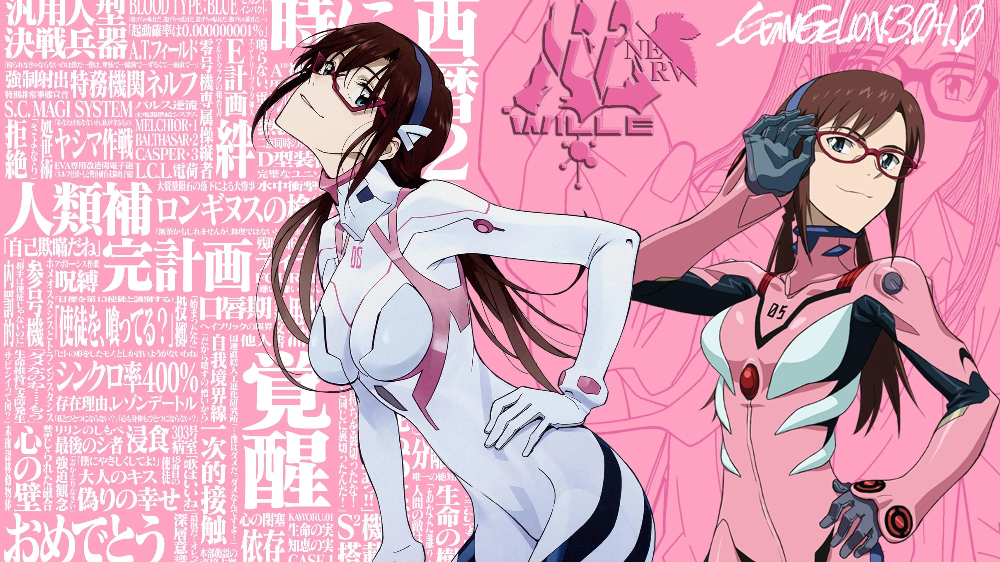

# 真希波 · EVA 装甲 HUD 皮肤（dsh-mari-skin）

> DeepSeek Harness 皮肤插件。**整体视觉由 CSS 变量 + `::before` / `::after` 伪元素实现**；唯一例外是开机动画——播放期间在 `<html>` 根节点下临时挂载一个全屏 `<video>`，它不进入 DSH 的 React 树、不参与交互，播放结束（或任何失败）后立即移除。

给 DSH 披上一层真希波配色的 EVA 装甲 HUD：粉白玻璃面板、霓虹描边、扫描线与 CRT 噪点、以及一段与开机动画对齐的入场动效。



---

## 特性

| 效果                           | 实现方式                                                     | 稳定性                                                       |
| ------------------------------ | ------------------------------------------------------------ | ------------------------------------------------------------ |
| 全局换色                       | 覆盖官方 `--dsw-alias-*` / `--dsw-specific-*` 令牌           | 高：官方组件全部走这些变量                                   |
| 背景插画                       | `body` 背景图（`assets/bg.jpg`，由插件静态路由提供）         | 高：官方 `body` 背景未被占用                                 |
| 网格 / 扫描线 / 噪点           | `body::before` 多重背景，`z-index:-1` 不挡点击               | 高：官方未占用 `body` 伪元素                                 |
| 暗角                           | `body::after` 径向渐变                                       | 高：同上                                                     |
| 霓虹描边 / 玻璃面板            | `inset` 阴影 + `backdrop-filter`，作用于输入卡片等面板       | 中：依赖官方 `data-*` 属性                                   |
| 输入框角标文字                 | `[data-composer-card]::before` 纯文字，不占布局              | 中：若官方日后占用伪元素，只失去角标                         |
| 插件页毛玻璃                   | 外层容器与子条目分别设 blur / 透明度                         | 中：依赖 `data-plugin-scope` / `data-plugin-entry`           |
| 新会话 HUD 横幅                | `[data-conversation-content][data-content-phase="hero"]::before` 载入 `5.png`，裁掉白边后**整体等比缩到 82%** 居中；侧栏收起时用 `max-width` 按住，不随主区域变宽而放大 | 中：只依赖官方 `data-content-phase` / `data-sidebar-collapsed`，仅空白新会话可见 |
| MARI'S MESSAGE 卡片            | `[data-composer-seat]::before` / `::after` 纯 CSS 文字，空白态才挂上 | 中：依赖 client.js 计算的 `data-dsh-blank`                   |
| 插件配置面 containment         | `box-sizing` + `min-width:0` + `overflow-wrap`，三级收束把配置项锁在父卡片内 | 高：只改「能不能缩」，不改任何实际尺寸                       |
| 插件配置面描边                 | 在详情 / 配置子树里重定向 `--dsw-alias-border-l1..l4`，统一成 `rgba(255,255,255,.15)`~`rgba(255,180,210,.25)` 的浅粉白 | 高：改的是令牌，官方新旧节点一起跟随；范围外不受影响         |
| hover 提亮 / 菜单底色 / 焦点环 | 语义选择器 + `filter` / `outline`                            | 高：`button`、`[role=menuitem]`、`:focus-visible`            |
| 分层入场动画                   | 官方已有容器 + `@keyframes mari-enter`                       | 高：默认无动画，属性出现才播                                 |
| 开机动画                       | 临时 `<video>` 全屏播放，结束即移除                          | 中：任何失败都直接跳过，界面不受影响                         |

**浅色 / 深色双档**都已适配：浅色是粉白玻璃，深色是深粉黑装甲（`body[data-ds-dark-theme]`），并自动把背景图压暗，避免浅底浅字看不清。

**无障碍**：保留全部语义与交互，只换色；`:focus-visible` 焦点环改跟随皮肤色；`prefers-reduced-motion: reduce` 下自动关闭所有动画。

---

## 安装

### 方式一：本地目录（开发 / 自用）

在插件目录的**上一级**执行（`--profile` 必填，`web` 是 profile 名）：

```bash
npx @deepseek-ai/dsh plugin --profile web add ./dsh-mari-skin
npx @deepseek-ai/dsh web
```

成功时**不应**出现 `declares no dsh.bundle` 警告。

### 方式二：从 GitHub 安装

```bash
npx @deepseek-ai/dsh plugin --profile web add https://github.com/SorenLorn/dsh-eva-mari-skin
```

### 方式三：插件市场

在 DSH 侧栏**插件 → 添加插件**里填入包名 `dsh-mari-skin` 即可。

### 卸载

```bash
npx @deepseek-ai/dsh plugin --profile web remove dsh-mari-skin
```

---

## 使用

装好后打开 DSH，皮肤自动生效，无需任何配置。

### 临时关闭皮肤

在地址栏给 URL 追加 `?noskin=1` 并刷新：

```
http://127.0.0.1:<port>/?noskin=1
```

此时插件**不设置** `data-dsh-skin` 属性，皮肤的全部规则立即失效，界面完全回到官方样式 —— 适合截图、排查问题、对照效果。去掉参数刷新即恢复。

`?noskin=0`（或任意其它值）视为**不关闭**。

### 只要皮肤、不要入场动画

追加 `?noboot=1`，或系统开启「减少动态效果」：两者都会让入场动画**直接跳过**（元素立刻就是最终状态，看不到过渡）。皮肤配色、背景图、装甲描边等全部照常生效。

注：`?noskin=1` 是关闭**整个皮肤**，与 `?noboot=1` 只关动画不同。

---

## 调色

所有颜色集中在 `skin.css` 的两处，改完刷新即可：

```css
/* §1 皮肤自用令牌：只在本皮肤作用域内生效，零冲突 */
html[data-dsh-skin="mari"] {
  --mari-neon:      #FF5C93;   /* 主描边 / 选中态 */
  --mari-neon-hot:  #FF3B5C;   /* 强调 / 警示 */
  --mari-neon-soft: #FFB3CE;   /* 次级文字 / 弱描边 */
  --mari-amber:     #FFA24D;   /* HUD 角标 */
  --mari-cyan:      #7FE3CF;   /* 状态点 */
  --mari-grid:      22px;      /* 网格间距 */
  --mari-cut:       16px;      /* 切角边长 */
}
```

```css
/* §4 官方令牌覆盖：浅色 / 深色各一套 */
html[data-dsh-skin="mari"] body:not([data-ds-dark-theme]) { /* 浅色档 */ }
html[data-dsh-skin="mari"] body[data-ds-dark-theme]        { /* 深色档 */ }
```

**换背景图**：替换 `assets/bg.jpg`（建议 16:9、≥2560×1440）。若要改文件名或路径，需同时改 `skin.css` 里的 `--mari-bg-image` 与 `lib/index.js` 里的 `ASSET_PREFIX`。

---

## 工作原理

```
package.json  (dsh.bundle.patch)
   └─ cordis.patch.yml         ← 激活清单：把插件挂进 profile 层（市场必需）
        └─ lib/index.js        ← Host：注册静态路由 + 注入 skin.css
             ├─ /mari-skin/*   ← 提供 assets/bg.jpg、boot.webm
             └─ <head><style>  ← skin.css 全文
lib/client.js                  ← Client：给 <html> 打属性，开机时临时挂 <video>
```

**样式怎么进页面**：Host 侧订阅官方的 `webserver/index-inject` 事件，把 `skin.css` 作为一条 `<style>` 行交给 HTTP 层渲染进 `<head>`。这是官方给插件准备的注入通道，不碰 React 树、不注册插槽。

**为什么不会污染 DSH 的 DOM**：`lib/client.js` 不创建任何常驻元素，只设置属性：

| 属性                         | 作用                                                         | 缺失时的表现                                       |
| ---------------------------- | ------------------------------------------------------------ | -------------------------------------------------- |
| `data-dsh-skin="mari"`       | 皮肤作用域。`skin.css` 每条规则都挂在这个选择器下            | 皮肤整体不生效，界面 = 官方原样                    |
| `data-dsh-skin-go="1"`       | 入场动画的起跑枪                                             | 元素保持官方原始可见状态，只是没有入场动画         |
| `data-dsh-skin-boot="1"`     | 开机视频期间冻结入场                                         | 无动画，界面正常                                   |
| `data-dsh-skin-caption`      | 由 JS 接管 Windows 原生标题条底色：开场纯黑 → 交接期 320ms 渐变到皮肤粉（值不参与选择器，只作开关） | 标题条固定为皮肤粉，开场黑视频上会看到一个粉色方块 |
| `data-dsh-sidebar-collapsed` | 折叠态镜像（只读同步，供 `::backdrop` 遮罩控制）             | 遮罩跟随官方原样                                   |

**关于唯一的一处 `<video>`**：开机动画需要一个真实的全屏播放器，这是本插件唯一创建的元素（它的两个 `<source>` 子节点随它一起移除；另外当浏览器不支持 `adoptedStyleSheets` 时，`client.js` 会回退插入一个 `<style>` 来承载 `::backdrop` 规则，卸载时一并移除）。它满足三条约束：

1. 挂在 `<html>` 直接子级，作为 `#root` 的**兄弟节点** —— React 看不见它，不会参与 reconcile；
2. `pointer-events:none`、`aria-hidden="true"`、`tabindex="-1"`、`muted` —— 不接收点击、不进无障碍树、不抢焦点；
3. 播放结束（`ended`）先淡出再 `remove()`，并解绑全部事件、释放解码器 —— 页面上不残留任何节点。

任何一步失败（404 / 解码失败 / 超时 / 自动播放被拦）都直接跳过，不会卡住界面。

所以**任何一环失败都不会白屏**：样式没注入 → 没皮肤；Client 没跑起来 → 属性不在 → 样式虽在页面里但全部不匹配 → 仍是官方界面。

### 入场动画与开机动画的交接

入场不依赖任何全局信号，只看「视频层什么时候撤干净」。四档降级，越靠前越精确：

| #    | 触发条件                                                     | 行为                                 |
| ---- | ------------------------------------------------------------ | ------------------------------------ |
| ①    | `ended` —— 开机视频播完                                      | 精确对齐：视频淡出、移除后才起跑入场 |
| ②    | `error` / 全部 `<source>` 加载失败 / 4 秒元数据超时（`VIDEO_LOAD_TIMEOUT`）/ 16 秒播放超时（`VIDEO_MAX_MS`） | 走同一条退场流程，不卡住界面         |
| ③    | 8 秒总保险丝（`FUSE_MS`）                                    | 无论上面发生什么都必然放行           |
| ④    | `?noboot=1` / `?noskin=1` / `prefers-reduced-motion`         | 根本不创建 `<video>`，立即放行       |

时序（分层错开，实测值）：

```
标题栏 +0ms → 顶栏 +80ms → 侧栏 +160ms → 主区 +240ms → 输入 +320ms → 右栏 +400ms
```

关键是写法反过来：**默认无动画，属性出现才播**。若写成"默认 `opacity:0`、等属性恢复"，一旦触发逻辑出问题就是全屏空白。

---

## 自检

在 DSH 的 DevTools Console 里：

```js
// 1) 皮肤作用域
document.documentElement.getAttribute('data-dsh-skin')            // "mari"
// 2) 入场动画已放行
document.documentElement.getAttribute('data-dsh-skin-go')         // "1"
// 3) 背景图已加载
getComputedStyle(document.body).backgroundImage.includes('mari-skin')  // true
// 4) 令牌已覆盖
getComputedStyle(document.body).getPropertyValue('--dsw-alias-label-primary')  // 浅色下 #3A1024
// 5) 样式已注入
[...document.querySelectorAll('style')].some(s => s.textContent.includes('dsh-mari-skin'))  // true
// 6) 开机结束后没有残留节点
document.querySelectorAll('.dsh-mari-boot-video').length          // 0
```

若第 1 项为 `null`，检查是不是带了 `?noskin=1`，或插件是否已启用。

---

## 已知限制

这些是**有意不做**的，写在这里避免以后误加：

- **不改侧栏宽度**：官方用 JS 计算 `grid-template-columns`，硬覆盖会破坏拖拽。
- **不占用 `.BynINW_frame::before`**：那是 Windows 标题栏拖拽区。
- **不给 `[data-sidebar-right-panel]` 加 `clip-path`**：它 `pointer-events:none` + `overflow:clip`，切角会切断内部点击，因此该面板只做描边与底色。
- **不做独立全屏扫描层 / 噪点层**：那需要新增常驻 DOM 节点，违反本插件约束；已合并进 `body::before` 的多重背景。
- **不改 `--dsw-radius-*`**：会影响所有圆角组件，局部圆角只在具体面板上单独声明。
- **不写死 `BynINW_` 开头的哈希类名**：每次构建都会变，只用属性 / 类名子串兜底。
- **不做逐卡错开的入场**：插件侧无法按卡片逐个加类，改为按列错开。

### 可能的失效点

官方改版后，依赖 `data-*` 属性和类名子串的效果最可能先失效，表现都只是"少一段装饰"，不影响功能：

- 输入卡片描边 / 角标 ← `data-composer-card`
- 右栏描边 ← `data-sidebar-right-panel`
- 各列入场动画 ← `data-shell-leading` / `data-shell-bottom` / `data-rightbar-col`
- 侧栏玻璃底 ← `[class*="sidebarCol"]` 等子串匹配

退化后皮肤仍保留"换色 + 背景图 + 网格噪点"，依旧可用。

---

## 性能

| 项                              | 说明                                                         |
| ------------------------------- | ------------------------------------------------------------ |
| `backdrop-filter: blur(22px)`   | 侧栏与输入卡片两处，低端机若掉帧可把 `--mari-glass-blur` 设为 `none` |
| `background-attachment: scroll` | 跟随 body 滚动，避免 `fixed` 在滚动容器里被降级重绘          |
| `animation: mari-scan-drift 9s` | 只动 `background-position`，GPU 友好；`prefers-reduced-motion` 下已关闭 |
| 噪点                            | 内联 SVG data URI，160×160 平铺，无额外请求                  |
| `clip-path`                     | 只在少量面板上使用，数量可控                                 |

---

## 文件结构

```
dsh-mari-skin/
├─ package.json          # main → lib/index.js，type=module，dsh.bundle.patch
├─ cordis.patch.yml      # 激活清单（插件市场必需，非调试文件）
├─ screenshots.json      # 插件市场截图清单（1-8 张，相对路径）
├─ lib/
│  ├─ index.js           # Host：静态路由 /mari-skin/* + index-inject 注入 skin.css
│  └─ client.js          # Client：只设置 <html> 的属性 + 开机时临时挂 <video>
├─ skin.css              # 全部皮肤样式，规则全部限定在 html[data-dsh-skin="mari"]
├─ assets/
│  ├─ bg.jpg             # 背景插画（同时是开机视频的 poster）
│  ├─ 3.png              # 工作页（插件 / 自动化）背景插画
│  ├─ 5.png              # 新会话页顶部 HUD 横幅（§20，等比 82%）
│  ├─ boot.webm          # 开机动画（VP9 / 1440p60，优先使用）
│  ├─ boot.mp4           # 开机动画回退源（H.264）
│  ├─ screenshot-1.jpg   # 插件市场截图 1
│  └─ screenshot-2.jpg   # 插件市场截图 2
└─ README.md
```

---

## 上架信息

本插件按 [awesome-dsh-plugin](https://github.com/awesome-dsh-plugin/awesome-dsh-plugin) 的收录规则准备：

- `package.json` 同时声明 `dsh.bundle`（必需，决定可安装性）与 `dsh.client`（前端 UI）；
- 在 awesome 列表中归入 **theme**（Themes & Appearance），会进入 dsh-market 的「主题」Tab；
- 截图通过仓库内的 `screenshots.json` 声明，换图只需推自己的仓库。

## 许可

MIT。背景插画与开机动画素材请确认你有权随包分发；若为第三方素材，请在此处补充来源与授权说明。
